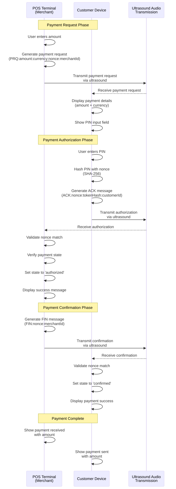

# Ultrasound Demo

A modern React application demonstrating ultrasound data transmission using [Quiet.js](https://github.com/quiet/quiet-js). This project showcases how data can be transmitted through sound waves, including payment systems, chat, and text transfer.

## 🏗️ System Architecture

The application is built with a modular React architecture that separates concerns between different communication modes while sharing common audio processing components.



### Component Relationships



## 🚀 Live Demo

[Deploy to Vercel](https://vercel.com/new/clone?repository-url=https://github.com/IFAKA/ultrasound-payments)

## ✨ Features

### 💳 Payment System
- **POS Terminal Interface**: Create payment requests with amounts
- **Customer Interface**: Authorize payments with PIN codes
- **Real-time Communication**: Ultrasound-based payment flow
- **Device Detection**: Automatically adapts to mobile/desktop

#### Payment Flow Process



The payment system implements a secure three-phase protocol:
1. **Payment Request**: POS terminal generates payment request with unique nonce
2. **Authorization**: Customer authorizes with PIN (hashed locally)
3. **Confirmation**: POS confirms payment completion

### 💬 Audio Chat
- **Real-time Messaging**: Send and receive text via ultrasound
- **Live Audio Visualization**: See frequency detection and audio levels
- **Multiple Profiles**: Choose from various transmission profiles
- **Message History**: Keep track of all communications

### 📝 Text Transfer
- **Bidirectional Transfer**: Send and receive text data
- **Transmission History**: View all sent and received messages
- **Character Limits**: Built-in limits for reliable transmission
- **Real-time Monitoring**: Audio level and frequency detection

## 🛠️ Technical Features

- **Multiple Transmission Profiles**: Standard ultrasonic (19kHz) and audible (4.2kHz)
- **Real-time Audio Visualization**: Live microphone activity display
- **Device Compatibility**: Works on desktop and mobile devices
- **Modern UI**: Dark theme with responsive design
- **Error Handling**: Robust error handling and user feedback

### Audio Processing Flow



The application implements sophisticated audio processing with:
- **Real-time Frequency Analysis**: Web Audio API with FFT analysis
- **Stable Frequency Display**: Weighted averaging with 500ms throttling
- **Audio Visualization**: Canvas-based frequency bars and level indicators
- **Quiet.js Integration**: Seamless audio encoding/decoding

## 🎯 Transmission Profiles

| Profile | Frequency | Use Case |
|---------|-----------|----------|
| Standard Ultrasonic | ~19kHz | Desktop, imperceptible |
| Feature Phone Compatible | ~4.2kHz | Audible range, low bitrate |

## 🚀 Getting Started

### Prerequisites
- Node.js 16+ 
- Modern web browser with microphone access
- HTTPS connection (required for microphone access)

### Installation

1. **Clone the repository**
   ```bash
   git clone https://github.com/IFAKA/ultrasound-payments.git
   cd ultrasound-payments
   ```

2. **Install dependencies**
   ```bash
   npm install
   ```

3. **Start development server**
   ```bash
   npm run dev
   ```

4. **Open in browser**
   - Navigate to `https://localhost:5173` (HTTPS required)
   - Allow microphone access when prompted

### Building for Production

```bash
npm run build
```

The built files will be in the `dist` directory, ready for deployment.

### Development Tools

The project includes development tools for documentation:

```bash
# Generate high-quality PNG diagrams (2000x1500, 2x scale)
npx mmdc -i docs/architecture.mmd -o docs/architecture.png -w 2000 -H 1500 -s 2 -b white
npx mmdc -i docs/payment-flow.mmd -o docs/payment-flow.png -w 2000 -H 1500 -s 2 -b white
npx mmdc -i docs/audio-flow.mmd -o docs/audio-flow.png -w 2000 -H 1500 -s 2 -b white
npx mmdc -i docs/component-relationships.mmd -o docs/component-relationships.png -w 2000 -H 1500 -s 2 -b white

# Generate vector SVG diagrams (recommended for sharpness)
npx mmdc -i docs/architecture.mmd -o docs/architecture.svg -b white
npx mmdc -i docs/payment-flow.mmd -o docs/payment-flow.svg -b white
npx mmdc -i docs/audio-flow.mmd -o docs/audio-flow.svg -b white
npx mmdc -i docs/component-relationships.mmd -o docs/component-relationships.svg -b white
```

### Project Scripts

```bash
npm run dev          # Start development server
npm run build        # Build for production
npm run preview      # Preview production build
npm run lint         # Run ESLint
```

## 🌐 Deployment

### Vercel (Recommended)

1. **Connect your repository** to Vercel
2. **Deploy automatically** - Vercel will detect the Vite configuration
3. **HTTPS is automatically enabled** for microphone access

### Other Platforms

The app can be deployed to any static hosting service:
- Netlify
- GitHub Pages
- AWS S3 + CloudFront
- Any CDN with HTTPS support

## 🔧 Technical Implementation

### Core Technologies

- **React 18**: Modern functional components with hooks
- **TypeScript**: Type-safe development
- **Vite**: Fast build tool and development server
- **Quiet.js**: Ultrasound communication library
- **Web Audio API**: Real-time audio processing
- **Canvas API**: Audio visualization

### Key Features Implementation

#### Mobile-First Responsive Design
- **Adaptive Headers**: Desktop shows full headers, mobile shows mode-specific headers
- **Flexible Audio Monitor**: Row layout on all screen sizes
- **Touch-Optimized**: Larger touch targets on mobile devices

#### Advanced Audio Processing
- **Frequency Averaging**: 1-second rolling window with weighted averaging
- **Update Throttling**: 500ms intervals to prevent UI flickering
- **Real-time Visualization**: Canvas-based frequency bars with smooth animations

#### Secure Payment Protocol
- **Nonce-based Security**: Unique tokens for each payment request
- **Local PIN Hashing**: SHA-256 hashing before transmission
- **State Management**: Comprehensive state tracking including payment-specific states (idle, listening, transmitting, processing, success, error, awaiting_payack, authorized, received_payreq, confirmed, sent_payack)
- **Message Deduplication**: Prevents duplicate message processing

### File Structure

```
src/
├── components/
│   ├── PaymentInterface.tsx    # Payment system with POS/Customer
│   ├── PaymentInterface.css    # Payment interface styles
│   ├── ChatInterface.tsx       # Real-time audio chat
│   ├── ChatInterface.css       # Chat interface styles
│   ├── TextInterface.tsx       # Text transfer system
│   ├── TextInterface.css       # Text interface styles
│   └── ProfileSelector.tsx     # Transmission profile selection
├── utils/
│   ├── quietInit.ts           # Quiet.js initialization utilities
│   └── logger.ts              # Logging utilities
├── types.ts                   # TypeScript type definitions
├── App.tsx                    # Main application component
├── App.css                    # Main application styles
├── main.tsx                   # Application entry point
└── index.css                  # Global styles
```

## 🔧 Configuration

### Environment Variables

No environment variables are required for basic functionality.

### Customization

- **Profiles**: Modify transmission profiles in `quiet-profiles.json`
- **UI Theme**: Customize CSS variables in `App.css`
- **Audio Settings**: Adjust audio parameters in component files

## 📱 Browser Compatibility

| Browser | Transmitter | Receiver | Notes |
|---------|-------------|----------|-------|
| Chrome | ✅ | ✅ | Full support |
| Chrome (Android) | ✅ | ⚠️ | Partial support |
| Edge | ✅ | ✅ | Full support |
| Firefox | ✅ | ⚠️ | Limited to 16kHz and below |
| Safari | ✅ | ❌ | No microphone support |
| Safari (iOS) | ✅ | ❌ | No microphone support |

## ⚡ Performance & Optimization

### Audio Processing Optimizations
- **Efficient FFT Analysis**: 1024-point FFT with optimized smoothing
- **Memory Management**: Automatic cleanup of audio contexts and buffers
- **Frame Rate Control**: RequestAnimationFrame for smooth 60fps updates
- **Buffer Management**: Rolling frequency buffer with automatic cleanup

### UI Performance
- **Conditional Rendering**: Mobile headers unmounted on desktop
- **State Optimization**: Refs for immediate state access, useState for UI updates
- **Event Throttling**: 500ms throttling for frequency display updates
- **Canvas Optimization**: High DPI support with device pixel ratio scaling

### Bundle Optimization
- **Code Splitting**: Component-based lazy loading
- **Tree Shaking**: Unused code elimination
- **Asset Optimization**: Compressed Quiet.js library files
- **Modern Build**: Vite for fast development and optimized production builds

## 🔒 Security Considerations

- **HTTPS Required**: Microphone access requires secure connection
- **No Data Storage**: All data is transmitted in real-time only
- **Local Processing**: No data is sent to external servers
- **PIN Security**: Payment PINs are hashed locally before transmission
- **Message Deduplication**: Prevents replay attacks with timestamp validation
- **Nonce-based Security**: Unique tokens prevent payment request replay

## 🤝 Contributing

1. Fork the repository
2. Create a feature branch (`git checkout -b feature/amazing-feature`)
3. Commit your changes (`git commit -m 'Add amazing feature'`)
4. Push to the branch (`git push origin feature/amazing-feature`)
5. Open a Pull Request

## 📄 License

This project is licensed under the MIT License - see the [LICENSE](LICENSE) file for details.

## 🙏 Acknowledgments

- [Quiet.js](https://github.com/quiet/quiet-js) - The core ultrasound communication library
- [libquiet](https://github.com/quiet/quiet) - The underlying C library
- [Vite](https://vitejs.dev/) - Fast build tool and dev server
- [React](https://reactjs.org/) - UI framework
- [Mermaid](https://mermaid-js.github.io/) - Diagram generation for documentation
- [TypeScript](https://www.typescriptlang.org/) - Type-safe JavaScript development

## 📞 Support

- **Issues**: [GitHub Issues](https://github.com/IFAKA/ultrasound-payments/issues)
- **Discussions**: [GitHub Discussions](https://github.com/IFAKA/ultrasound-payments/discussions)
- **Documentation**: [Quiet.js Docs](https://quiet.github.io/quiet-js/docs/)

---

**Note**: This is a demonstration project. For production use, additional security measures and testing would be required.
